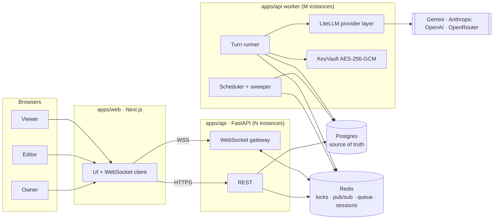

# Multigent

**Shared, real-time AI chats.** A chat's owner plugs in their own LLM API key (Gemini, Anthropic, OpenAI, OpenRouter, or any OpenAI-compatible endpoint). Invited people chat with the same model in the same live conversation, on the owner's key. Everyone watches the replies stream, and when several people ask at once, the AI answers each of them by name.

> 📽️ **Demo:** _GIF placeholder: three browsers sending at once, one batched reply that addresses each person, a mid-stream reconnect._

**Highlights**

- **Multiplayer by design:** invites with roles (owner / editor / viewer), presence, typing indicators, live member changes.
- **Mentions, and the AI only when you ask:** the AI reads along but replies only when someone mentions `@AI`. Mention people (`@Bob`, `@everyone`) and their messages are highlighted for them; the AI knows who said what to whom. Turn on *off the record* and a message stays between humans (the model never sees it).
- **Correct under concurrency:** a strict per-chat event order, at most one reply running per chat, simultaneous messages batched into one reply, nothing lost or answered twice, even if a worker is killed mid-reply.
- **The owner's key stays secret:** encrypted at rest, write-only, decrypted only for the provider call, and never in any response, event, log or error. A test proves it.
- **Works with a free Gemini key:** rate-limit aware (backoff with a live countdown, request pacing), rolling summaries for long chats, spend caps.

## Architecture



- **web:** a UI only, no secrets.
- **api:** stateless. It writes messages, publishes events and serves the WebSocket. It never makes chat calls to an LLM.
- **worker:** the same codebase run as a separate process. It schedules turns, builds prompts, calls providers, streams tokens, summarizes long chats and records usage.

A slow or crashing model call can never block message intake, and each tier scales on its own. The full design is in [docs/ARCHITECTURE.md](docs/ARCHITECTURE.md).

## How concurrency works

1. **Total order.** Every event in a chat (message, reply, join, key change…) gets a `seq` from `UPDATE chats SET last_seq = last_seq + 1 … RETURNING` in the same transaction as the event. The row lock makes commit order equal `seq` order with no gaps; events are published only after commit.
2. **Batching.** A new message schedules the chat in a Redis sorted set at `now + 800 ms` using `ZADD NX`. Later messages don't push that time back, so people typing at the same moment land in **one batch**. Messages that arrive *while* a reply is streaming show "Queued · will be answered next" and form the next batch.
3. **One reply at a time.** A worker that wins the wake-up takes a per-chat Redis lock (with heartbeat), and a partial unique index in Postgres (`one running turn per chat`) backs it up. Every later write is **fenced** on the turn's lock token, so a paused or zombie worker can't double-write.
4. **Exactly once.** Sends are idempotent on a client-generated id, so retries and reconnects never duplicate. If a worker dies, its lock expires; the **sweeper** fails the orphaned reply and re-queues its batch, which is answered once. Redis is only coordination: flush it and the sweeper rebuilds the queue from Postgres.
5. **Who said what.** Each human message reaches the model in a server-built `<message from="Alice" role="editor">` tag, with the content escaped so nobody can forge another speaker. The system prompt tells the model to answer each person under their name.
6. **Live without gaps.** Clients subscribe with their last `seq`. The server subscribes to pub/sub *first*, replays missed events from Postgres, then flushes live ones (deduped by `seq`). A client joining mid-reply gets a snapshot of the text so far, then deltas deduped by chunk index.

A stress test runs 3 workers, 3 chats and 4 users × 8 messages, and checks continuously that a chat never has two replies running, that `seq` is gapless, and that every message is batched exactly once.

## Security model for API keys

- **Encrypted at rest** with AES-256-GCM, a random nonce per key, and the **chat id + provider as associated data**, so a ciphertext can't be moved to another chat. Master keys can be rotated, behind a KMS-ready interface.
- **Write-only:** after saving, even the owner sees only `•••• last4`. Collaborators see whether the key works, nothing more.
- **Decrypted only in the worker**, immediately before each provider call, and passed as an argument, never stored.
- **Never leaks:** logs (including uvicorn's access log) and every provider error go through a redactor that knows key formats *and* the exact key in use. Validation errors never echo input. The key is never in the model's context, so prompt injection can't extract it.
- **Proven:** [`test_key_never_leaks`](apps/api/tests/test_key_never_leaks.py) drives every endpoint with a deliberately leaky provider and finds the key in no response, event, Redis value, database column or log line.

More in [docs/SECURITY.md](docs/SECURITY.md).

## Run it locally

Requires Docker (plus Node 22 + pnpm and [uv](https://docs.astral.sh/uv/) only for running the tests).

```bash
git clone <this repo> multigent && cd multigent
cp .env.example .env
docker compose up -d --build
```

Open http://localhost:3000, sign in with any name and email (dev login), create a chat, and pick **Demo (no key)** to try it without an API key, or **Google Gemini** with a [free key](https://aistudio.google.com/app/apikey). Open an invite link in a private window to join as a second person.

API docs: http://localhost:8000/docs. Postgres and Redis are exposed on host ports 15432 and 16379.

## Tests

| Suite | Command | What it covers |
|---|---|---|
| Backend (281) | `cd apps/api && uv run pytest` | Real Postgres + Redis: ordering, batching, crash recovery, stress, authz matrix, key secrecy, invites, caps, summaries, OAuth (mocked IdP), WebSocket resume against a live server |
| Frontend (69) | `pnpm --filter @multigent/web test` | Event reducer, WS client reconnect/outbox, markdown safety, components |
| End-to-end (9) | `pnpm --filter @multigent/web e2e` (stack running) | Three real browsers: simultaneous sends batched and addressed by name, reconnect mid-stream, queueing, viewer can't send, invite flow, axe accessibility scans |
| Lint / types | `uv run ruff check . && uv run mypy app tests` · `pnpm lint && pnpm typecheck` | mypy strict, TypeScript strict |

## Tech stack

**Backend:** Python 3.12, FastAPI, SQLAlchemy 2 (async) + Alembic, asyncpg, redis-py, LiteLLM, cryptography, structlog. **Frontend:** Next.js 15 (App Router), TypeScript, Tailwind v4, shadcn/ui, TanStack Query, react-markdown + shiki, a typed client generated from OpenAPI. **Data:** Postgres 16, Redis 7. **Tooling:** uv, pnpm, Ruff, mypy, ESLint, Vitest, Playwright, GitHub Actions.

## Repository layout

```
apps/api     FastAPI app + worker (app/turns: engine, app/realtime: WebSocket, app/security: keys/redaction)
apps/web     Next.js frontend (src/lib/ws: reducer + client, src/features: chat UI) and e2e tests
docs/        ARCHITECTURE.md · SECURITY.md · DEPLOY.md · API.md
```

## Deploying

Web on Vercel; API and worker as two services from one image on Fly.io, Render or Railway, with managed Postgres and Redis. Step by step, including OAuth setup: [docs/DEPLOY.md](docs/DEPLOY.md).
